

# toluajibola.com

**The personal site of Tolu Ajibola · Revenue Operations & GTM Systems**

[**Visit the live site →**](https://toluajibola.com)

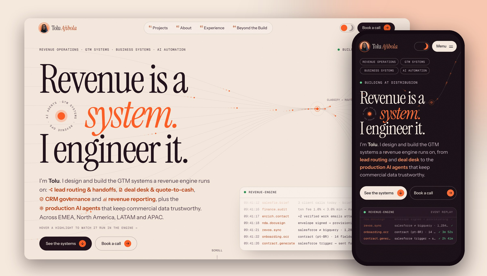

## What it is

A hand-built portfolio that replaced a Framer template. It's designed for people hiring for Revenue Operations, GTM Systems and Business Systems roles, so it leads with the work itself: ten revenue systems I've designed and run in production, each with a short case study, the outcome it produced, and the principles behind how I build.

The tagline is the thesis: **revenue is a system, and I engineer it.** The site tries to behave like one. Data flows through the hero, a live "revenue engine" log replays real kinds of events, and every outcome counts up from its "before" to its "after".

## How I wanted it to look

**I didn't want another template.** My old site was a Framer theme: tidy, but it could have belonged to anyone. I wanted something that felt like me and that made the case for the kind of work I do before anyone read a word.

**The idea: revenue is a system.** My work is wiring the pipeline, the handoffs and the data that a revenue team runs on, so the site should feel like a working system rather than a brochure. Data flows through the hero into a "classify → route" hub, an engine log replays the kinds of events my systems handle, and every outcome counts up from its "before" to its "after". Even the career section is a changelog, with each role shipped as a version.

**Warm and colourful, not neutral.** I took cues from two sites I admire: oyin.design for its warmth and editorial confidence, and wodniack.dev for motion that feels engineered. Neither was a blueprint. The result is a warm paper and deep plum base with one orange "signal" colour reserved for anything you can act on (buttons, arrows, highlights), plus a soft pastel for each system so every project has its own identity. Both light and dark themes were designed on purpose, not inverted.

**Type with a voice.** A tall serif (Instrument Serif) carries the headlines and gives the personality. A clean sans (Instrument Sans) keeps the reading easy, and a monospace (Geist Mono) handles labels, so the small print reads like system output.

**Motion that means something.** Nothing moves just to move. Lines carry data, numbers roll to their real values, cards stack the way work queues up, and animations replay when you scroll back instead of playing once and going still.

**Phones as their own design.** On mobile, systems, outcomes and principles become sticky card decks you scroll through, an idea I kept from my old site because it felt right in the hand.

**Sweating the details.** Spacing follows one rhythm, so the gap under a block matches the gap above it. Layouts respond to the space they actually have, so opening a browser sidebar never breaks a line. Arrows are orange, so they read as "go" before you hover.

## How I build

Four rules run through the work, and the site animates each one:

|  |  |  |  |
| :-: | :-: | :-: | :-: |
| **Map the motion** | **Architect the truth** | **Automate with guardrails** | **Measure, then harden** |
| Trace each handoff across teams first | One source of truth, explicit rules | Dry runs, audit trails, no silent writes | Ship, watch it in production, then harden |

## The first screen

| Desktop · light | Desktop · dark |
| :-: | :-: |
| 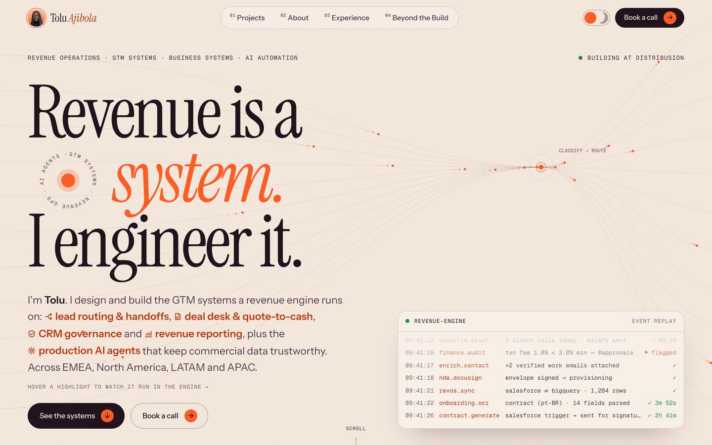 | 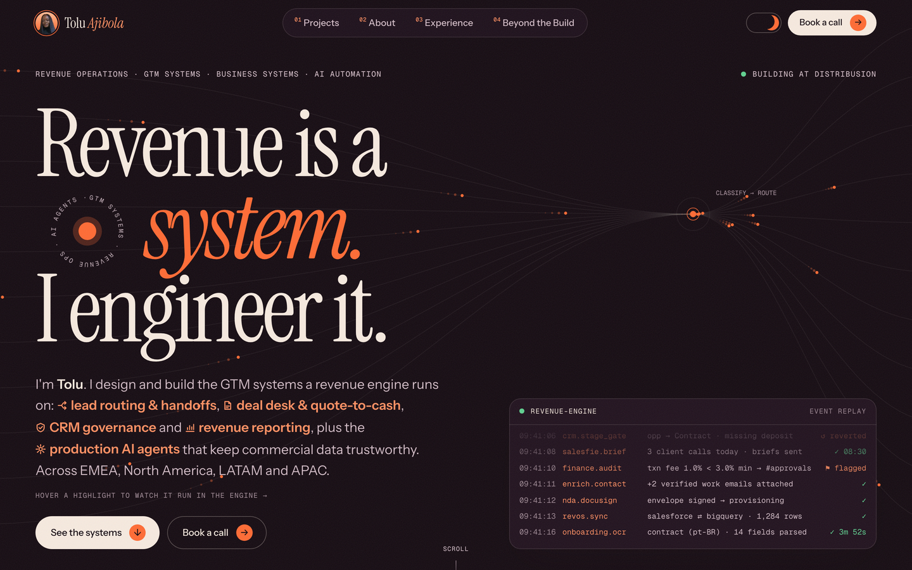 |

| Phone · light | Phone · dark |
| :-: | :-: |
| 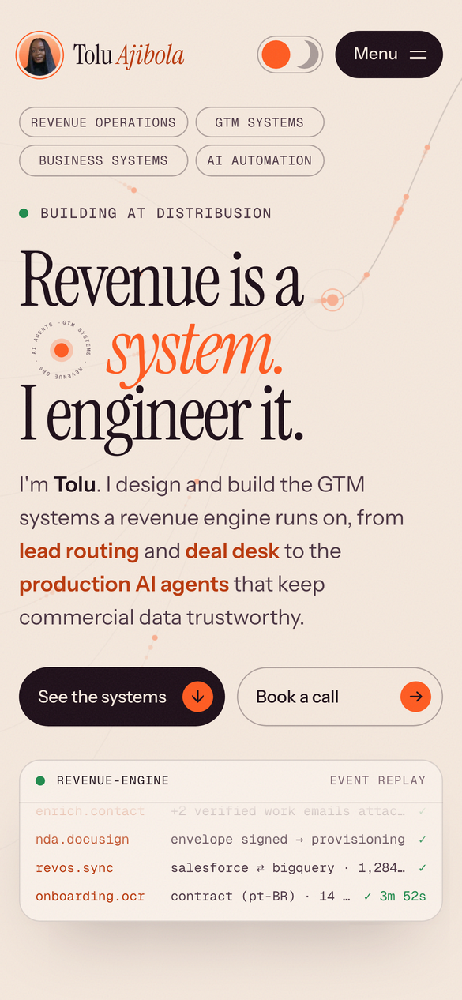 | 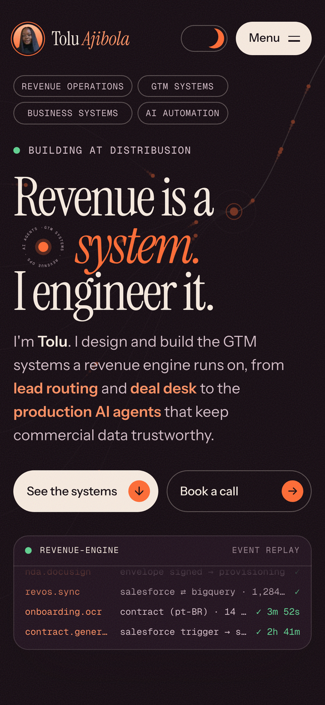 |

## A closer look

| Selected systems, on hover | Outcomes |
| :-: | :-: |
| 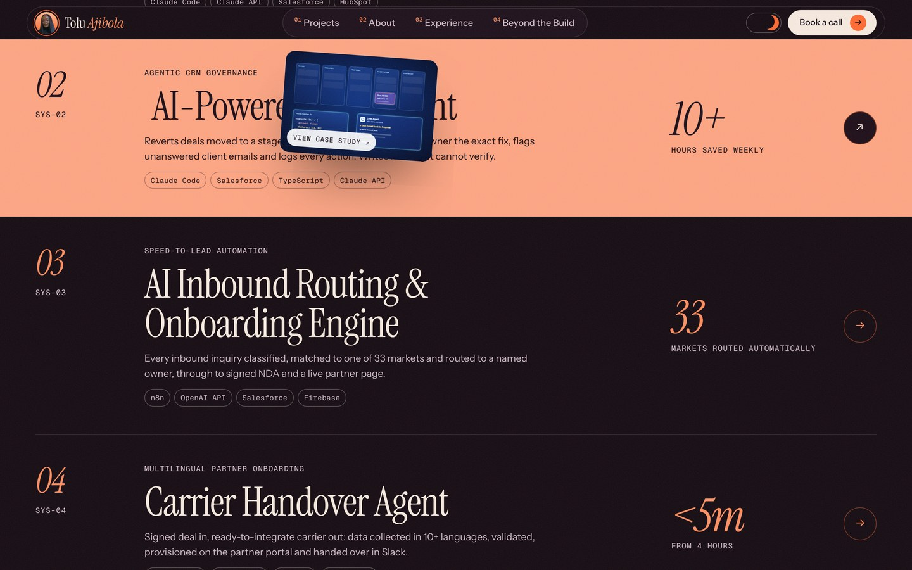 | 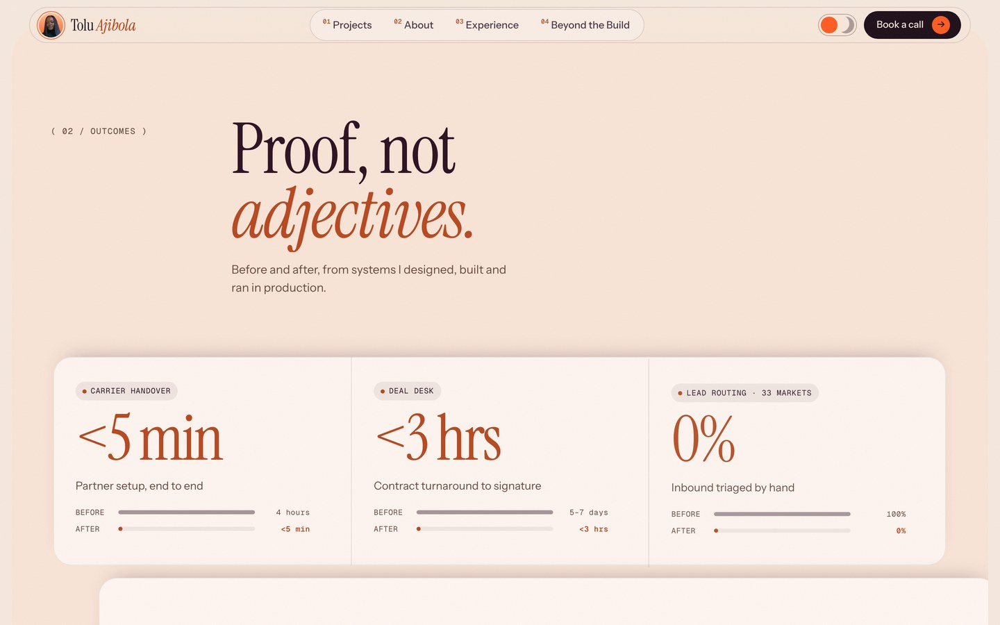 |
| **How I build** | **Toolkit** |
| 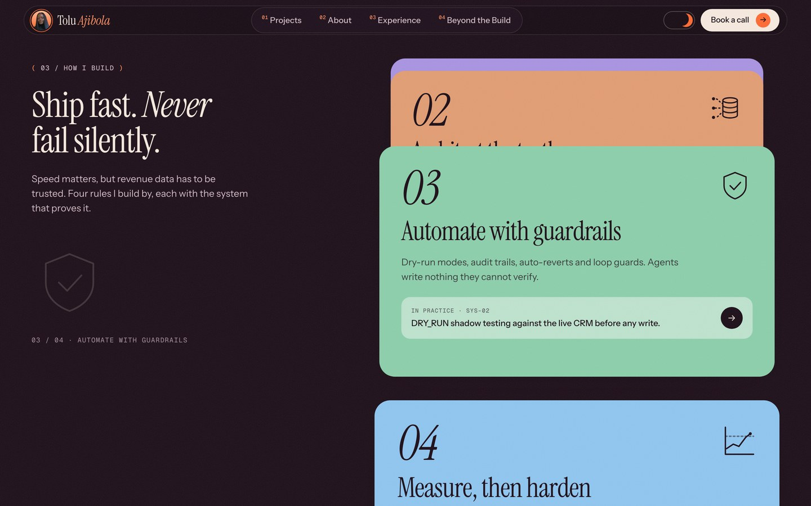 | 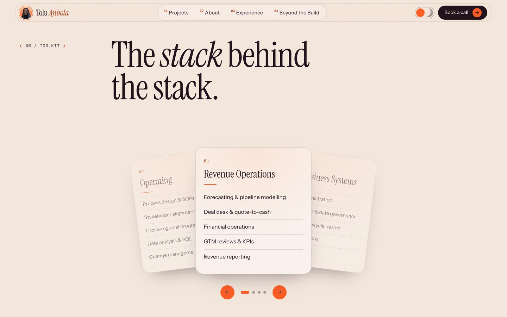 |
| **About** | **A case study** |
| 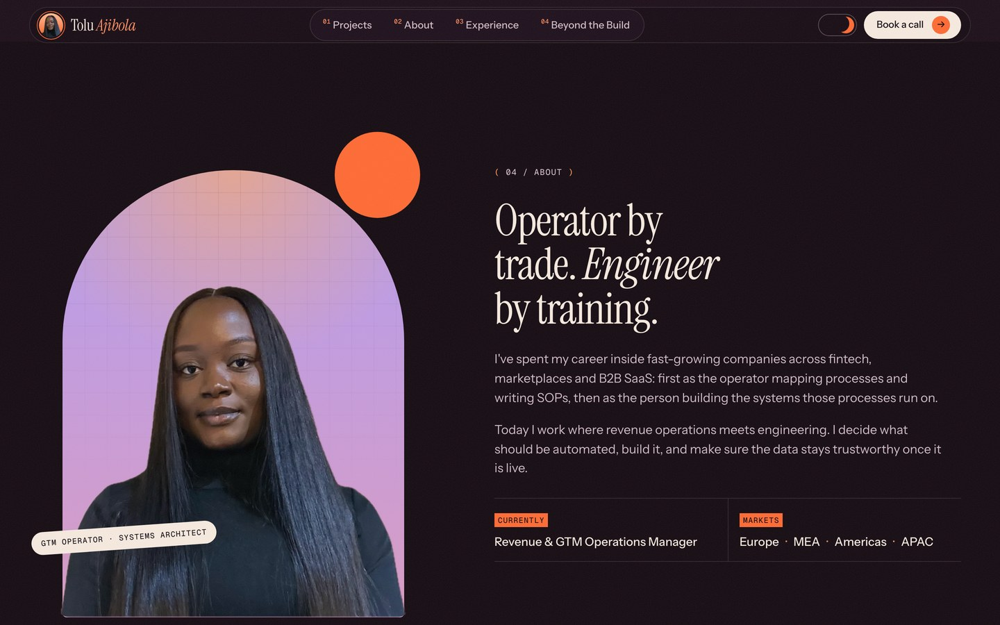 | 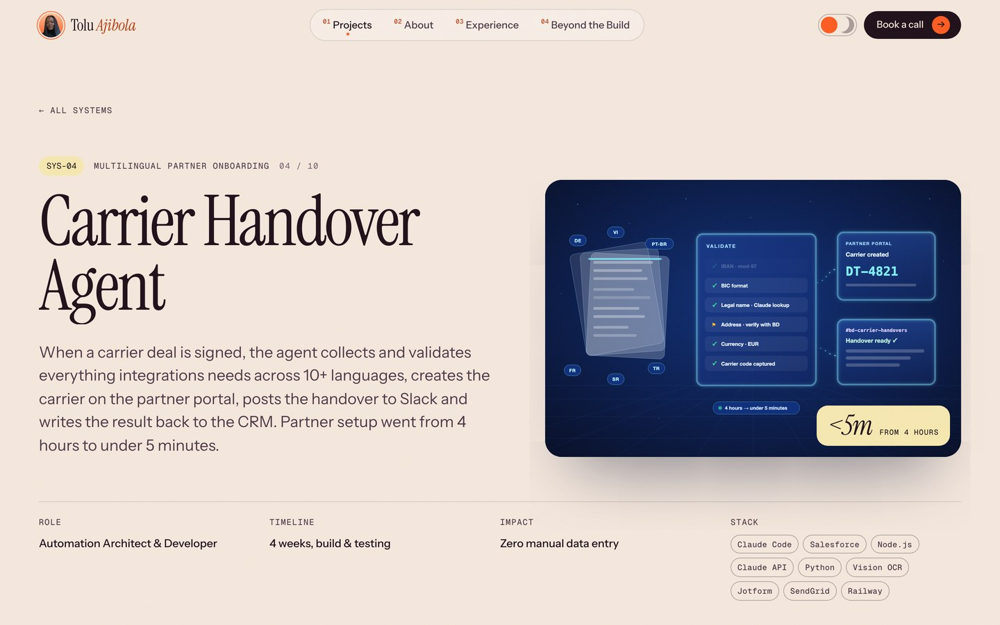 |

## Highlights

- **Two full themes.** Light and dark are designed separately, not inverted, and switching plays a circular reveal from the toggle.
- **A hero that behaves like a pipeline.** A canvas of routes feeds a "classify → route" hub, and a terminal-style engine log replays events. Hovering a topic in the intro filters the log to that topic.
- **Stats that replay.** Outcome numbers roll like an odometer and their before/after bars fill each time they come into view, not just once.
- **Card decks, done properly.** Systems, outcomes and principles stack as sticky decks on phones, and the toolkit fans out like a hand of cards that rotates on its own.
- **Layouts that respect the space they have.** Container queries, not just screen sizes, decide layouts, so a browser sidebar or split screen never squeezes text into broken lines.
- **Artwork generated from code.** Every system has an animated illustration built by a script, sharing one visual language (below).
- **Accessible by default.** Real headings and landmarks, labelled controls, and every animation respects the reduced-motion setting.

## Artwork generated from code

Each case study gets an animated SVG produced by a small Node script: one shared stage, glass panels and wiring, with the parts specific to that system.

| Deal intelligence | Inbound routing | Partner handover |
| :-: | :-: | :-: |
|  |  |  |

## How it's put together

- **Static first.** Astro renders every page to plain HTML at build time. There's no client framework: the only JavaScript is the motion layer.
- **Content in one place.** Projects, outcomes, principles and experience live in a single typed data file, and every page is generated from it. Adding a system means adding one entry.
- **A separate motion layer.** GSAP (ScrollTrigger, SplitText) handles scroll-driven animation, and Lenis smooths the scroll. Everything degrades gracefully without it.
- **Design tokens.** Colour, type and spacing are CSS custom properties, which is what makes the two themes and the per-system colours cheap to maintain.
- **Deploys on push.** Netlify builds and publishes on every push to `main`.

## Code samples

The site's source is private, but here are a few self-contained pieces from it:

| File | What it does |
| --- | --- |
| [`snippets/odometer.ts`](snippets/odometer.ts) | Digit-by-digit rolling numbers that size themselves in `em` and can replay on every scroll pass |
| [`snippets/fan-deck.ts`](snippets/fan-deck.ts) | The rotating fanned deck: timer, dots, arrows, click-to-front, and replaying each card's entrance |
| [`snippets/fan-deck.css`](snippets/fan-deck.css) | The deck's layout, using container queries to switch between the fan and a sticky phone deck |

## Built with

Astro · TypeScript · GSAP · Lenis · Instrument Serif, Instrument Sans and Geist Mono · Netlify

---

Want to know how any part of it was built? I'm happy to walk you through it: [LinkedIn](https://www.linkedin.com/in/tolu-ajibola/) · [toluajibola.com](https://toluajibola.com)
